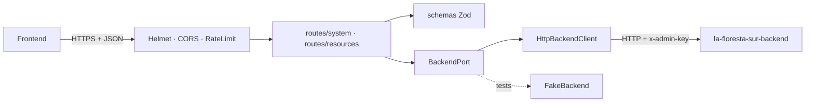
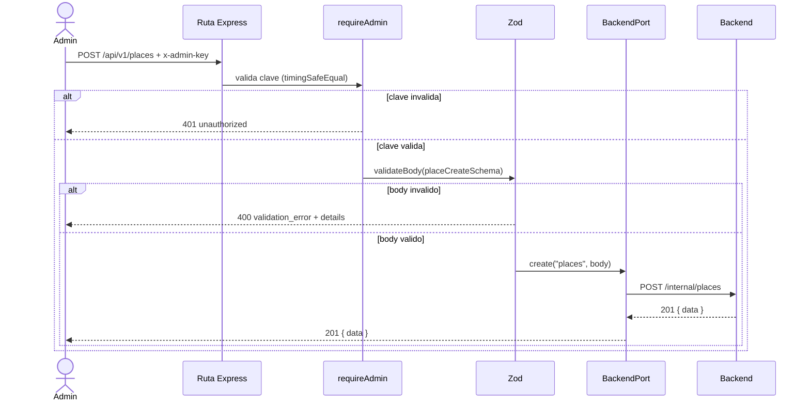
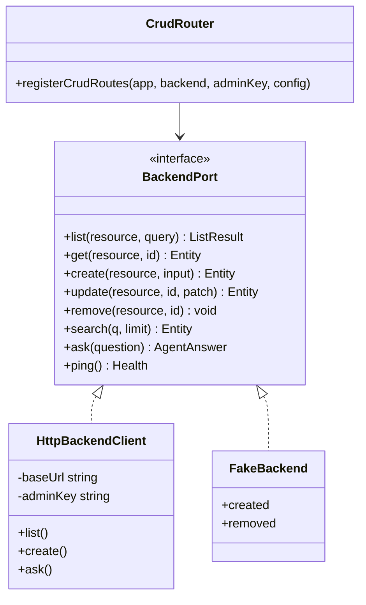
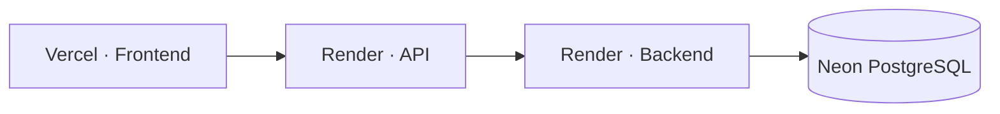

# Arquitectura de la API

## 1. Capas dentro del repositorio

```text
rutas (Express)  ->  schemas (Zod)  ->  BackendPort  ->  HttpBackendClient  ->  backend
```

- **Rutas:** solo orquestan; no saben de SQL ni de URLs del backend.
- **Schemas:** validan y normalizan (SRP).
- **BackendPort:** interfaz (DIP); las pruebas inyectan `FakeBackend`.
- **HttpBackendClient:** traduce errores y normaliza `{ items }` a `{ data, meta }`.

## 2. Diagrama de componentes



## 3. Diagrama de secuencia: POST /places



## 4. Diagrama de clases



## 5. Decisiones

| Decisión | Motivo |
| --- | --- |
| API separada del backend | El backend no se expone; la API controla validación y CORS |
| Zod `strict()` | Evita mass assignment y campos inesperados |
| `x-admin-key` + `timingSafeEqual` | Suficiente para demo pública, sin usuarios |
| `FakeBackend` en pruebas | Pruebas rápidas y deterministas (DIP) |
| Rate limit 600/15 min | Protege el plan gratuito del backend |
| 502 para fallos del backend | Diferencia caída interna de error del cliente |

## 6. Despliegue


